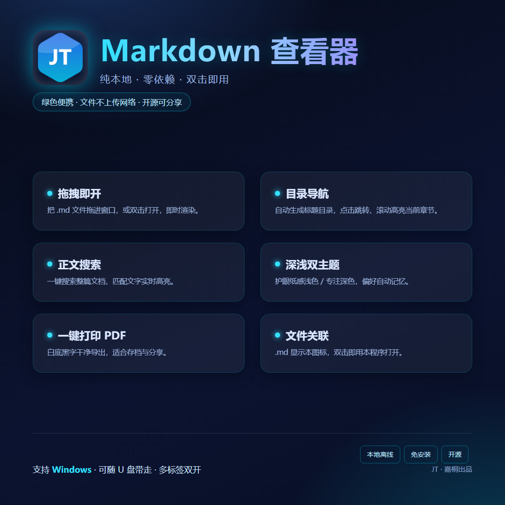

# Markdown 查看器 (MdViewer)


一个**轻量、纯本地离线**的 Markdown 阅读器：双击 `MdViewer.exe` 即用，无需安装 Python、无需联网。支持拖拽打开、目录导航、正文搜索高亮、深色 / 浅色主题记忆、一键打印 PDF，双击正文任意区块即可**就地编辑并写回源文件**，还可以把电脑里的 `.md` 文件关联成本程序专属图标、双击直达。



## ✨ 特性

- **零依赖**：纯 Python 标准库实现（HTTP 服务 + 手写 Markdown 渲染器），无任何第三方包
- **纯本地**：所有解析在本机完成，文件不上传任何网络
- **纸感阅读**：Notion / GitHub 式暖白纸感配色，界面退后、内容向前；深色主题一键切换并记忆
- **目录导航**：自动按标题生成侧栏目录，点击跳转、滚动高亮当前章节
- **正文搜索**：输入关键字，整篇文档实时高亮
- **打印 PDF**：白底黑字干净导出（自动修复深色主题下打印变"白纸"的问题）
- **文件关联**：`安装关联.bat` 一键让 `.md` 显示本程序图标、双击打开（仅当前用户，无需管理员）
- **多标签双开**：不同 `.md` 各自独立标签互不干扰；空窗口全局唯一，反复双击 exe 只聚焦不堆窗
- **双击就地编辑**：开启编辑模式后，双击正文任意区块（标题 / 段落 / 列表 / 表格 / 代码块 / 引用）即可就地修改，保存后**直接写回 .md 源文件**并立即重新渲染——不用再开别的编辑器
- **绿色便携**：整个文件夹拷到 U 盘 / 别的电脑直接用

## 🚀 快速开始

### 方式一：直接使用便携版（推荐）

下载仓库中的 `Markdown查看器_便携版.zip`（或从 Releases 获取），解压后双击 `MdViewer/MdViewer.exe` 即可。

### 方式二：从源码运行

```bash
# 需要 Python 3.8+（纯标准库，无需 pip install）
python mdviewer.py            # 打开空窗口
python mdviewer.py 文档.md    # 直接打开指定文档
```

### 方式三：自行打包 exe

```bash
# 1. 创建构建环境（含 PyInstaller，仅需一次）
prepare_buildenv.bat
# 2. 打包
build.bat
# 产物在 dist/MdViewer/
```

## 📖 使用说明

| 操作 | 方式 |
| --- | --- |
| 打开文档 | 拖拽 `.md` 进窗口 / 点「📂 打开 .md」/ 双击已关联的 `.md` / 命令行 `MdViewer.exe 文档.md` |
| 文件关联 | 双击 `安装关联.bat`（取消用 `卸载关联.bat`） |
| 搜索 | 右上角输入框，实时高亮 |
| 编辑 | 开启「✏️ 编辑」后双击正文区块，改完按 Ctrl+Enter 直接写回源文件 |
| 主题 | 「🌗 主题」按钮，深 / 浅记忆 |
| 打印 PDF | 「🖨 打印」→ 另存为 PDF |
| 退出 | 「⏻ 退出」关闭后台服务；所有窗口关闭 30 分钟后也会自动退出 |

完整手册见 [docs/使用说明.md](docs/使用说明.md)。

> 文件关联写入的是当前用户注册表（`HKCU\Software\Classes`），不需要管理员权限；文件夹挪位置后重新运行一次 `安装关联.bat` 即可。

## 🔨 项目结构

```
MdViewer/
├── mdviewer.py        # 本地 HTTP 服务 + 单实例/双开/空窗口唯一逻辑
├── mdrender.py        # 手写 Markdown → HTML 渲染器（纯标准库）
├── frontend.py        # 前端页面（内联 HTML/CSS/JS，双主题）
├── build.bat          # PyInstaller 打包脚本
├── prepare_buildenv.bat
├── 安装关联.bat        # .md 文件关联（含图标缓存刷新）
├── 卸载关联.bat
└── assets/icon.ico    # JT 六边形品牌图标
```

## 🧊 设计说明

- **单后台服务架构**：第一次启动创建本地 HTTP 服务（端口写入 `%TEMP%\mdviewer.port`），后续启动复用同一服务
- **空窗口唯一**：空窗口通过 `/api/home-wait` 长轮询等待焦点；再次双击 exe 时后端只触发 `/api/home-trigger` 聚焦已有窗口，不再新开标签
- **渲染器**：支持标题 / 嵌套列表 / 引用 / 代码块 / 表格 / 行内样式 / 图片 / 分割线等常用语法

## 📄 License

[MIT](LICENSE) © 2026 JT·嘉桐
